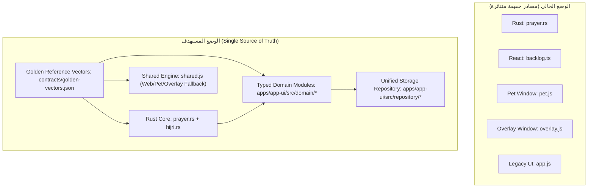

# الخطة الهندسية الشاملة لتحصين معمارية «وِنس» (Wens Architectural Hardening Blueprint)

> [!IMPORTANT]
> **الهدف من هذه الوثيقة:**
> هذه الخطة مصممة لتكون **مرجعاً تنفيذياً كاملاً (Zero-Ambiguity Execution Spec)** لأي نموذج ذكاء اصطناعي أو مهندس برمجيات سيقوم بالتنفيذ. كل مرحلة تحتوي على المسارات الدقيقة للملفات، أرقام الأسطر، تواقيع الدوال (Function Signatures)، هياكل البيانات، القيود الصارمة، وأوامر التحقق التي يجب أن تنجح بنسبة 100% قبل الانتقال للمرحلة التالية.

---

## تشخيص الوضع الراهن (لماذا تحدث الأعطال الصامتة؟)

تطبيق «وِنس» يعاني حالياً من **٤ ثغرات معمارية هيكلية** هي السبب الجذري في كل خطأ ظهر أو سيظهر مستقبلاً:

1. **تعدد مصادر الحقيقة الفلكية والشرعية (Split-Brain Calculators):**
   معادلات مواقيت الصلاة والتقويم الهجري مكتوبة **٥ مرات** في المشروع:
   - نواة Rust: [`crates/core-rust/src/prayer.rs`](file:///h:/Others/Wens/crates/core-rust/src/prayer.rs#L30-L196)
   - محرك واجهة React الحديثة: [`apps/app-ui/src/backlog.ts`](file:///h:/Others/Wens/apps/app-ui/src/backlog.ts#L1055-L1196)
   - نافذة الرفيق العائم (Floating Pet Window): [`pet.js`](file:///h:/Others/Wens/pet.js#L191-L262)
   - نافذة الشريط الشفاف (Overlay Widget Window): [`overlay.js`](file:///h:/Others/Wens/overlay.js#L47-L128)
   - الواجهة الكلاسيكية القديمة: [`app.js`](file:///h:/Others/Wens/app.js#L1966-L2068) (بل ومكررة مرتين داخل نفس الملف: `calculatePrayerTimesLocal` و`calculatePrayerTimes`!).
2. **انفصام حالة التخزين المحلي (Storage Sprawl & Disconnected State):**
   البيانات موزعة بدون طبقة تنسيق موحدة (Repository Layer) بين قاعدة بيانات SQLite في Rust (`schema_v2.sql`) وبين ٦ مفاتيح منفصلة في `localStorage`:
   - `wens-local-v1` (الحالة الكلاسيكية والمشتركة مع `pet.js` و`overlay.js`)
   - `wens-prayer-backlog-v1` (سجل قضاء الصلوات والصيام في [`backlog.ts`](file:///h:/Others/Wens/apps/app-ui/src/backlog.ts#L59))
   - `wens-fasting-intentions` (نوايا الصيام في [`backlog.ts`](file:///h:/Others/Wens/apps/app-ui/src/backlog.ts#L1787))
   - `wens-checks-YYYY-MM-DD` (إنجاز الصلوات والصيام اليومي في [`main.tsx`](file:///h:/Others/Wens/apps/app-ui/src/main.tsx) و[`backlog.ts`](file:///h:/Others/Wens/apps/app-ui/src/backlog.ts#L317))
   - `wens-khatma-v2` (حالة ختمة القرآن في [`main.tsx`](file:///h:/Others/Wens/apps/app-ui/src/main.tsx))
   - `wens-adhkar-YYYY-MM-DD` (تقدم الأذكار اليومية)
3. **تضخم الملفات المركزية (God Files):**
   - [`apps/app-ui/src/main.tsx`](file:///h:/Others/Wens/apps/app-ui/src/main.tsx) وصل إلى **~4,500 سطر** يخلط بين ١٠ شاشات، وحالة الصوت، والتنبيهات، والطقس، والعبادات.
   - [`apps/app-ui/src/backlog.ts`](file:///h:/Others/Wens/apps/app-ui/src/backlog.ts) وصل إلى **~2,000 سطر** يخلط بين الفلك، التقويم الهجري، المواسم الدينية، حساب القبلة، وسجل القضاء.
4. **اختبارات سطحية أو مقيدة بنصوص ثابتة (Brittle String-Matching Tests):**
   ملف [`smoke-test.mjs`](file:///h:/Others/Wens/smoke-test.mjs) يفحص وجود سلاسل نصية حرفية داخل `app.js` و`pet.js` و`overlay.js`، وملف [`prayer-regression-test.mjs`](file:///h:/Others/Wens/prayer-regression-test.mjs) يستخرج دالة `calculatePrayerTimes` نصياً عبر `vm.runInNewContext`. أي تعديل غير مدروس دون مراعاة هذه القيود يكسر أنبوب الاختبار (`npm test`).



---

## القواعد الحاكمة للموديل المنفذ (Strict Rules for the Executing Agent)

> [!CAUTION]
> **ممنوعات صارمة أثناء التنفيذ:**
> 1. **لا تشغل `rg` أو أي أداة بحث على جذر المشروع بالكامل دون استثناء المجلدات الضخمة:** مجلد العمل يحتوي على `.android-sdk` و`.cargo` و`target` و`node_modules`. أي بحث يجب أن يُحصر في: `apps crates src-tauri contracts shared.js pet.js overlay.js app.js`.
> 2. **لا تحذف `app.js` أو `pet.js` أو `overlay.js` عشوائياً:** نافذتا `pet.html` و`overlay.html` هما نافذتان حقيقيتان تعملان داخل Tauri (`WebviewUrl::App("pet.html")` و`WebviewUrl::App("overlay.html")` في [`src-tauri/src/lib.rs`](file:///h:/Others/Wens/src-tauri/src/lib.rs))، وملفا [`smoke-test.mjs`](file:///h:/Others/Wens/smoke-test.mjs) و[`prayer-regression-test.mjs`](file:///h:/Others/Wens/prayer-regression-test.mjs) يتحققان منهما.
> 3. **لا تنشئ كائنات `new Intl.DateTimeFormat(...)` داخل الدوال أو الحلقات:** يجب تعريف جميع منسقات `Intl.DateTimeFormat` كـ Singletons على مستوى الملف (Module-level Singletons) لتجنب خطأ `FATAL ERROR: Zone Allocation failed - process out of memory` في محرك V8 على Windows.
> 4. **حافظ على إعدادات Vitest في [`apps/app-ui/vite.config.ts`](file:///h:/Others/Wens/apps/app-ui/vite.config.ts):** لا تزل `maxWorkers: 1` و`fileParallelism: false` لتجنب استنزاف الذاكرة عند تشغيل `jsdom`.
> 5. **كل مرحلة تنتهي بتشغيل أمر التحقق الشامل:** لا تنتقل من مرحلة إلى التي تليها إلا بعد نجاح:
>    - `cargo test --workspace`
>    - `node smoke-test.mjs`
>    - `node prayer-regression-test.mjs`
>    - `npm run test:vnext`
>    - `node sync-desktop-assets.mjs`

---

## المرحلة الأولى (Phase 1): توحيد الحسابات الفلكية والهجرية عبر جميع النوافذ (`Rust` + `vNext` + `Pet` + `Overlay` + `Legacy`)

### ١.١ إصلاح ثغرة طرق الحساب في `pet.js` و`overlay.js` و`app.js`
حالياً، عندما يختار المستخدم «تقويم أم القرى» في واجهة React الحديثة ([`main.tsx`](file:///h:/Others/Wens/apps/app-ui/src/main.tsx))، تُحفظ القيمة في الإعدادات باسم `'umm_al_qura'`، أو `'muslim_world_league'`، أو `'north_america'`، أو `'karachi'`.
لكن في:
- [`overlay.js`](file:///h:/Others/Wens/overlay.js#L90-L96): الكود يحول النص إلى `normalizedMethod = String(method || '').toLowerCase().replace(/[-_]/g, '')` (فتصبح `'ummalqura'`)، ثم في السطر 96 يفحص `else if (method === 'ummalqura')` بدلاً من `normalizedMethod === 'ummalqura'`! فينهار الشرط ويعود لحساب الهيئة المصرية.
- [`pet.js`](file:///h:/Others/Wens/pet.js#L233-L239): نفس الخطأ بالضبط في السطر 239 (`else if (method === 'ummalqura')`).
- [`app.js`](file:///h:/Others/Wens/app.js#L1971-L1977) و[`app.js`](file:///h:/Others/Wens/app.js#L2044-L2045): لا يدعم أصلاً `normalizedMethod` ولا يعرف `'umm_al_qura'` أو `'muslim_world_league'` أو `'karachi'` أو `'north_america'`.

#### المطلوب تنفيذه في المرحلة ١.١:
1. في [` shared.js `](file:///h:/Others/Wens/shared.js):
   أضف دالة موحدة قياسية داخل كائن `WensShared`:
   ```javascript
   function resolvePrayerMethodParams(method) {
     const norm = String(method || 'egypt').toLowerCase().trim().replace(/[-_]/g, '');
     if (norm === 'mwl' || norm === 'muslimworldleague') {
       return { fajrAngle: 18.0, ishaAngle: 17.0, ishaMinutesAfterSunset: null };
     }
     if (norm === 'ummalqura') {
       return { fajrAngle: 18.5, ishaAngle: 17.5, ishaMinutesAfterSunset: 90.0 };
     }
     if (norm === 'karachi') {
       return { fajrAngle: 18.0, ishaAngle: 18.0, ishaMinutesAfterSunset: null };
     }
     if (norm === 'isna' || norm === 'northamerica') {
       return { fajrAngle: 15.0, ishaAngle: 15.0, ishaMinutesAfterSunset: null };
     }
     if (norm === 'dubai') {
       return { fajrAngle: 18.2, ishaAngle: 18.2, ishaMinutesAfterSunset: null };
     }
     // Default: Egyptian General Authority of Survey ('egypt')
     return { fajrAngle: 19.5, ishaAngle: 17.5, ishaMinutesAfterSunset: null };
   }
   ```
2. في [`overlay.js`](file:///h:/Others/Wens/overlay.js#L89-L97)، [`pet.js`](file:///h:/Others/Wens/pet.js#L232-L240)، و[`app.js`](file:///h:/Others/Wens/app.js#L1966-L2046):
   حدّث شروط `normalizedMethod` في الدوال الثلاث لتدعم جميع الصيغ (`normalizedMethod === 'ummalqura'`, `'mwl' | 'muslimworldleague'`, `'karachi'`, `'isna' | 'northamerica'`).
   > [!WARNING]
   > **انتبه لقيد الاختبارات في [`smoke-test.mjs`](file:///h:/Others/Wens/smoke-test.mjs#L70) و[`prayer-regression-test.mjs`](file:///h:/Others/Wens/prayer-regression-test.mjs#L9):**
   > - يجب بقاء التعليق أو النص `fajrAngle: 19.5, ishaAngle: 17.5` داخل `app.js` و`pet.js` و`overlay.js` لأن السطر 70 من `smoke-test.mjs` يتحقق منه نصياً.
   > - يجب أن تظل دالة `function calculatePrayerTimes(` في `app.js` و`pet.js` و`overlay.js` قابلة للاستدعاء المستقل بدون اعتمادات خارجية لأن `prayer-regression-test.mjs` يستخرج جسم الدالة ويشغله في `vm.runInNewContext`.
3. احذف الدالة المكررة غير المستخدمة `calculatePrayerTimesLocal` من [`app.js`](file:///h:/Others/Wens/app.js#L1966-L2000) أو اجعلها تستدعي `calculatePrayerTimes` مباشرة لمنع التكرار.

### ١.٢ إضافة أوامر جدول الشهر والأسبوع في نواة Rust (`crates/core-rust` & `src-tauri`)
حالياً، [`apps/app-ui/src/api.ts`](file:///h:/Others/Wens/apps/app-ui/src/api.ts#L546-L569) يستدعي أمر Tauri `prayer_day` ليوم واحد فقط، بينما جدول الشهر (`calculateMonthPrayerTable`) وجدول الأسبوع (`calculateWeekPrayerTable`) يُحسبان في المتصفح عبر TypeScript فقط، والـ fallback في [`api.ts:localPrayerFallback`](file:///h:/Others/Wens/apps/app-ui/src/api.ts#L530-L544) يعيد أوقاتاً ثابتة جامدة (`303, 389, 778...`) بدلاً من استخدام المحرك الفلكي الفعلي!

#### المطلوب تنفيذه في المرحلة ١.٢:
1. في [`apps/app-ui/src/api.ts`](file:///h:/Others/Wens/apps/app-ui/src/api.ts#L530-L569):
   استبدل الأرقام الجامدة في `localPrayerFallback()` باستدعاء حسابي حقيقي من [`calculateMonthPrayerTable`](file:///h:/Others/Wens/apps/app-ui/src/backlog.ts#L1055) لنفس اليوم، مع تمرير `settings.latitude`, `settings.longitude`, `settings.calcMethod`, `settings.fajrOffset`, `settings.maghribOffset`, `settings.ishaOffset`. بهذا، حتى في وضع المتصفح (Browser Fallback)، تعطي `getPrayerDay()` مواقيت فلكية دقيقة ١٠٠٪ بدلاً من أوقات وهمية ثابتة.
2. في [`crates/core-rust/src/prayer.rs`](file:///h:/Others/Wens/crates/core-rust/src/prayer.rs):
   أضف دالة `pub fn calculate_prayer_month(year: i32, month: u32, request_template: PrayerRequest) -> Result<Vec<PrayerDay>, PrayerError>` وأضف لها اختبار وحدة في `prayer.rs` يتحقق من تطابق مخرجاتها مع جدول هيئة المساحة المصرية لشهر أغسطس ٢٠٢٦ وأكتوبر ٢٠٢٦ لجميع طرق الحساب الخمس.

### ١.٣ إنشاء ملف المتجهات القياسية المرجعية (`contracts/golden-astronomy-hijri-vectors.json`)
لمنع أي انحراف بين Rust وTypeScript وJavaScript:
1. أنشئ ملف `contracts/golden-astronomy-hijri-vectors.json` يحتوي على:
   - **متجهات التقويم الهجري (Umm al-Qura Reference Vectors):** ٣٠ تاريخاً مفصلياً عبر السنوات ٢٠٢٥–٢٠٢٨ تغطي بدايات ونهايات الشهور (٢٩ و٣٠)، رمضان، عرفة، عاشوراء، والأيام البيض (بما فيها `2026-10-23 -> 1448-05-12`, `2026-10-24 -> 1448-05-13`, `2026-10-25 -> 1448-05-14`, `2026-10-26 -> 1448-05-15`).
   - **متجهات مواقيت الصلاة (Prayer Calculation Vectors):** مواقيت الفجر والشروق والظهر والعصر والمغرب والعشاء لـ ٥ مدن/طرق حساب (`egypt`, `umm_al_qura`, `muslim_world_league`, `karachi`, `north_america`).
2. أضف اختباراً في [`prayer-regression-test.mjs`](file:///h:/Others/Wens/prayer-regression-test.mjs) وفي [`apps/app-ui/src/backlog.test.ts`](file:///h:/Others/Wens/apps/app-ui/src/backlog.test.ts) يقرأ هذا الملف ويتحقق من تطابق `app.js`, `pet.js`, `overlay.js`, و`backlog.ts` معه بدقة ١٠٠٪.

---

## المرحلة الثانية (Phase 2): تفكيك `backlog.ts` (٢٠٠٠ سطر) إلى وحدات نطاقية معزولة (Domain Modules Decomposition)

> [!IMPORTANT]
> **شرط التوافق الخلفي (Zero Breaking Imports):**
> بعد تقسيم [`apps/app-ui/src/backlog.ts`](file:///h:/Others/Wens/apps/app-ui/src/backlog.ts) إلى وحدات داخل `apps/app-ui/src/domain/`، يجب أن يبقى ملف `apps/app-ui/src/backlog.ts` كواجهة تصدير مجمعة (`Barrel Re-export File`: `export * from './domain/...'`) حتى لا ينكسر أي استيراد حالي في `main.tsx` أو ملفات الاختبارات `*.test.ts`.

### الهيكل الجديد لوحدات النطاق داخل `apps/app-ui/src/domain/`:

| الملف الجديد | المسؤولية الدقيقة والدوال المنقولة إليه من `backlog.ts` |
| :--- | :--- |
| `apps/app-ui/src/domain/formatters.ts` | جميع منسقات `Intl.DateTimeFormat` كـ Singletons (`ummAlQuraFormatter`, `arBacklogDateFormatter`, `arFullDateFormatter`, `arLongWeekdayFormatter`, `arShortWeekdayFormatter`)، ودوال `formatArabicDigits`, `toLocalDateString`, `parseLocalDate`, `formatBacklogDate`, `formatArabicDateDisplay`, `formatTimeMinutes`, `formatDiffDaysToCountdown`. |
| `apps/app-ui/src/domain/hijri-calendar.ts` | `HIJRI_MONTH_NAMES`, `HijriDateResult`, `gregorianToHijri` (مع الـ Cache والـ Anchoring عند الساعة 12:00 ظهراً والـ Fallback الجدولي). |
| `apps/app-ui/src/domain/astronomy.ts` | `calculateQiblaBearing`, `getQiblaCompassDirection`, `calculateSuhoorTime`, `MonthPrayerDayRow`, `calculateMonthPrayerTable`, `calculateWeekPrayerTable`, `getTomorrowPrayerTimes`. **تحسين أداء إلزامي:** في `calculateWeekPrayerTable`، احسب جدول الشهر مرة واحدة لكل `(year, monthIndex)` في الأسبوع (بحد أقصى شهرين إذا وقع الأسبوع في نهاية شهر) بدلاً من استدعاء `calculateMonthPrayerTable` ٧ مرات متتالية داخل الحلقة! |
| `apps/app-ui/src/domain/sunnah-occasions.ts` | الأنواع `MajorOccasionItem`, `ReligiousHolidayItem`, `WhiteDayItem`, `SunnahFastingInfo`، ودالة `getUpcomingSunnahDays(fromDate, hijriOffset)`. |
| `apps/app-ui/src/domain/worship-backlog.ts` | الأنواع والثوابت الخاصة بسجل قضاء الصلوات والصيام (`BacklogState`, `PrayerBacklogItem`, `FastingBacklogItem`, إلخ)، ودوال `loadBacklogState`, `saveBacklogState`, `reconcilePrayerBacklog`, `reconcileFastingBacklog`, `addPrayerBacklogItem`, `resolvePrayerBacklogItem`, `markPrayerBacklogAsMissed`, `reopenPrayerBacklogItem`, `addFastingBacklogItem`, `resolveFastingBacklogItem`, `markFastingBacklogAsMissed`, `reopenFastingBacklogItem`, `computeBacklogSummary`, `getFastingIntentions`, `saveFastingIntention`, `isFastingDateCompleted`, `recordFastingCompletion`. |

---

## المرحلة الثالثة (Phase 3): بوابة التخزين الموحدة (Unified Storage Repository)

### المشكلة التي تعالجها هذه المرحلة:
حالياً، [`main.tsx`](file:///h:/Others/Wens/apps/app-ui/src/main.tsx) يقرأ ويكتب في `localStorage` مباشرة في أكثر من ٢٠ موضعاً (`wens-checks-${todayKey}`, `wens-khatma-v2`, `wens-adhkar-${todayKey}`, `wens-local-v1`)، كما أن نافذة الرفيق [`pet.js`](file:///h:/Others/Wens/pet.js#L289-L315) تكتب في `wens-local-v1` و`wens-checks-${key}` عبر `BroadcastChannel('wens-state')`.

### المطلوب تنفيذه في المرحلة ٣:
1. إنشاء `apps/app-ui/src/repository/worship-storage.ts` ليكون البوابة الوحيدة (Single Gateway) لجميع عمليات القراءة والكتابة المتعلقة بالعبادات في المتصفح:
   - **`getDailyChecks(dateStr: string): DailyWorshipChecks`** و**`setDailyCheck(dateStr: string, field: 'fajr' | 'sunrise' | 'dhuhr' | 'asr' | 'maghrib' | 'isha' | 'fasting', completed: boolean): DailyWorshipChecks`**:
     - تحدث `wens-checks-${dateStr}`
     - وتحدث `wens-local-v1` (`accountability.days[dateStr]`) في نفس اللحظة (Atomic Sync)
     - وتبث التغيير عبر `BroadcastChannel('wens-state')` و`syncStorage` لتتحدث نافذتا `pet.html` و`overlay.html` لحظياً.
   - **`getKhatmaState(): KhatmaState`** و**`saveKhatmaState(next: KhatmaState): void`**:
     - تتحقق من صحة الأرقام (`currentJuz` بين `1..30`، `currentPage` بين `1..604`، `targetDays` أكبر من `0`) قبل الحفظ في `wens-khatma-v2`.
   - **`getEffectiveHijriOffset(settings?: Partial<AppPreferences>): number`**:
     - تقرأ `hijriDateOffset` من `settings` أولاً، وإذا لم يمرر تقرؤه من `wens-local-v1` (`settings.hijriDateOffset ?? settings.hijriOffset ?? 0`) وتقيده في النطاق `-5..5`.
2. في [`apps/app-ui/src/domain/worship-backlog.ts`](file:///h:/Others/Wens/apps/app-ui/src/backlog.ts):
   استخدم `getDailyChecks` و`setDailyCheck` و`getEffectiveHijriOffset` داخل `reconcilePrayerBacklog` و`reconcileFastingBacklog` و`recordFastingCompletion` لضمان عدم حدوث أي تعارض بين ما يراه المستخدم في شاشة «اليوم» وما يراه في شاشة «العبادة» أو «الرفيق العائم».

---

## المرحلة الرابعة (Phase 4): تفكيك ملف الواجهة الضخم `main.tsx` (٤٥٠٠ سطر) إلى شاشات معزولة

### الوضع الحالي في [`apps/app-ui/src/main.tsx`](file:///h:/Others/Wens/apps/app-ui/src/main.tsx):
الملف يحتوي على جميع المكونات والشاشات في ملف واحد، مما يجعل تعديل أي شاشة محفوفاً بمخاطر كسر الشاشات الأخرى.

### المطلوب تنفيذه في المرحلة ٤:
تفكيك الشاشات والمكونات المشتركة تدريجياً إلى مجلدات واضحة مع الحفاظ على كل الـ `data-testid` والـ `className` والنصوص العربية التي تعتمد عليها اختبارات [`react-components.test.tsx`](file:///h:/Others/Wens/apps/app-ui/src/react-components.test.tsx) و[`audit-fixes.test.tsx`](file:///h:/Others/Wens/apps/app-ui/src/audit-fixes.test.tsx):

1. `apps/app-ui/src/utils/arabic-digits.ts`:
   نقل دالة `digits()` ودوال تنسيق الوقت المشتركة.
2. `apps/app-ui/src/components/CommandPalette.tsx`:
   نقل مكون لوحة الأوامر السريعة (`Ctrl+K`).
3. `apps/app-ui/src/components/CriticalAlarmModal.tsx`:
   نقل نافذة تحدي الاستيقاظ للسحور والمنبه القوي.
4. `apps/app-ui/src/views/TodayView.tsx`:
   نقل مكون `TodayView` بالكامل.
5. `apps/app-ui/src/views/WorshipView.tsx`:
   نقل مكون `WorshipView` بالكامل.
6. `apps/app-ui/src/views/WorkAndProjectsViews.tsx`:
   نقل `WorkView`, `ProjectsView`, `IdeasView`, `StudioView`.
7. `apps/app-ui/src/views/SettingsAndSystemViews.tsx`:
   نقل `SettingsView`, `HistoryView`, `DevicesView`, `ModulesView`.

> [!WARNING]
> **قيد اختبار في [`smoke-test.mjs`](file:///h:/Others/Wens/smoke-test.mjs#L64):**
> السطر 64 من `smoke-test.mjs` يقرأ ملف `apps/app-ui/src/main.tsx` نصياً ويتحقق من:
> `['today', 'worship', 'work', 'projects', 'ideas', 'studio', 'history', 'devices', 'modules', 'settings'].every((view) => vnextMain.includes("id:'" + view + "'")) && vnextMain.includes('event.ctrlKey') && vnextMain.includes('CommandPalette')`
> لذلك **يجب** أن تبقى مصفوفة التنقل `navItems` (التي تحتوي على `id:'today'`, `id:'worship'`, إلخ) ومستمع اختصار `event.ctrlKey` واستدعاء `<CommandPalette` داخل [`apps/app-ui/src/main.tsx`](file:///h:/Others/Wens/apps/app-ui/src/main.tsx) نفسه!

---

## المرحلة الخامسة (Phase 5): منظومة اختبارات الحماية الشاملة (Property, Cross-Engine, & Time-Of-Day Guardrails)

لمنع أي تراجع (Regression) مستقبلي، يجب توسيع الاختبارات الآلية في `apps/app-ui/src/backlog.test.ts` و`apps/app-ui/src/react-components.test.tsx` لتشمل:

### ٥.١ اختبار رباعي الأوقات لكل يوم (4-Times-Per-Day State Machine Test)
أضف اختباراً في [`apps/app-ui/src/backlog.test.ts`](file:///h:/Others/Wens/apps/app-ui/src/backlog.test.ts) يفحص سلوك المحرك في ٤ لحظات حرجة من اليوم (`03:30` قبل الفجر، `10:00` الضحى، `16:00` العصر، `19:30` بعد المغرب) عبر التواريخ المفصلية:
1. **يوم ١٣ من الشهر الهجري (أول الأيام البيض) في الساعة `19:30` (بعد المغرب):**
   - `whiteDays.items[0].isToday === true`
   - `whiteDays.items[0].isPassed === false` (يظل متاحاً لتسجيل "صمت هذا اليوم" بعد الإفطار ولا يُقفل).
2. **يوم ١٥ من الشهر الهجري (ثالث الأيام البيض) في الساعة `19:30` (بعد المغرب):**
   - ينتقل `whiteDays` لعرض الأيام البيض للشهر الهجري القادم (`isCurrent === false`).
3. **وقت العشاء بعد منتصف الليل وقبل الفجر (`01:30` صباحاً):**
   - صلاة العشاء لليوم السابق تُسجل بسبب `'day-rollover'` وليس `'window-ended'` لأن وقتها الشرعي ممتد حتى الفجر.
4. **أيام النهي عن الصيام (عيد الفطر `10/1`، عيد الأضحى `12/10`، وأيام التشريق `12/11`, `12/12`, `12/13`):**
   - لا يظهر فيها أبداً نص `'اليوم هو موعد الصيام!'`.
   - تظل مناسبة `tashreeq_days` نشطة (`isToday === true`, `diffDays === 0`) في الأيام ١١ و١٢ و١٣ من ذي الحجة جميعاً.

### ٥.٢ اختبار تطابق الإعدادات بين الواجهة والمحرك (`Settings -> Engine End-to-End Integration Test`)
أضف اختباراً في [`apps/app-ui/src/react-components.test.tsx`](file:///h:/Others/Wens/apps/app-ui/src/react-components.test.tsx) يتحقق من:
1. تغيير «تصحيح التاريخ الهجري (`hijriDateOffset`)» في `SettingsView` من `0` إلى `+1` ثم فتح `TodayView` و`WorshipView`:
   - يتغير التاريخ الهجري المعروض في الشاشتين بمقدار `+1` يوم فوراً.
   - تتغير تواريخ الأيام البيض والمواسم الهجرية تبعاً للإزاحة الجديدة.
2. تغيير طريقة الحساب (`calcMethod`) في `SettingsView` إلى `umm_al_qura`:
   - يتغير جدول مواقيت الشهر (`calculateMonthPrayerTable`) بحيث يصبح وقت العشاء بعد المغرب بـ ٩٠ دقيقة تماماً.

---

## قائمة التحقق النهائية للتسليم (Definition of Done Checklist)

يجب على الموديل المنفذ تشغيل الأوامر التالية بالترتيب في نهاية العمل والتأكد من أن نتيجة كل أمر هي `Exit Code 0` بدون أي تحذير أو خطأ ذاكرة:

```powershell
# 1. اختبار نواة Rust وقاعدة البيانات والمزامنة
cargo test --workspace

# 2. اختبار التطابق الفلكي عبر المحركات الثلاثة (app.js, pet.js, overlay.js)
node prayer-regression-test.mjs

# 3. بناء واختبار حزمة الواجهة الحديثة واختبارات الثوابت (365-day invariants)
npm run test:vnext

# 4. مزامنة أصول سطح المكتب مع dist-vnext
node sync-desktop-assets.mjs

# 5. تشغيل فحص الدخان الشامل (109 فحوصات معمارية)
node smoke-test.mjs
```
